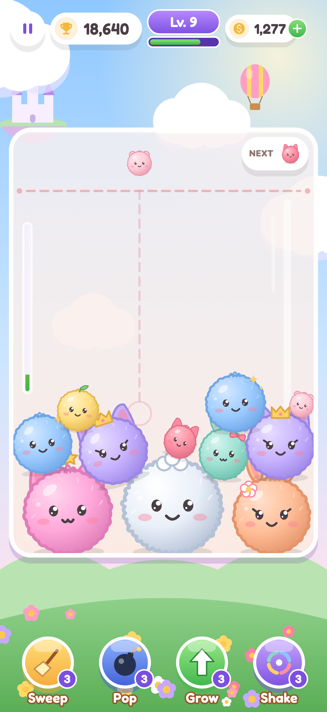
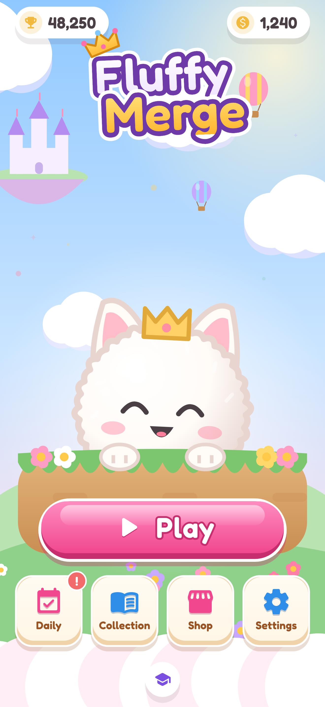
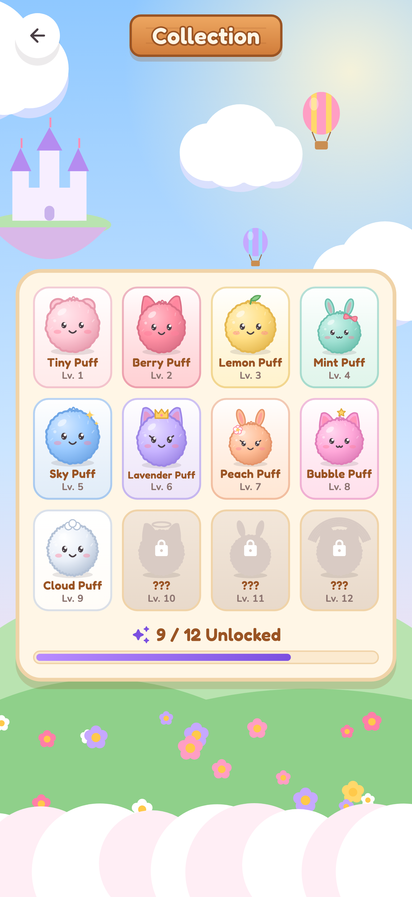
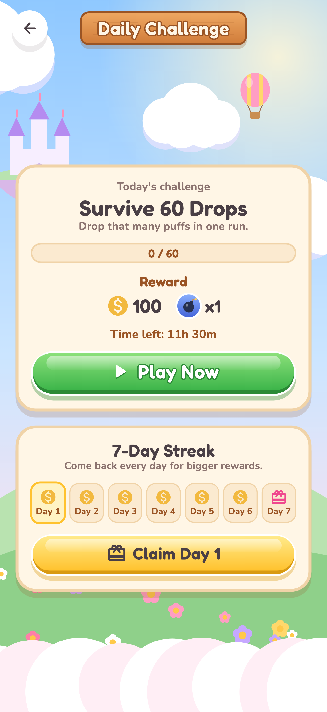
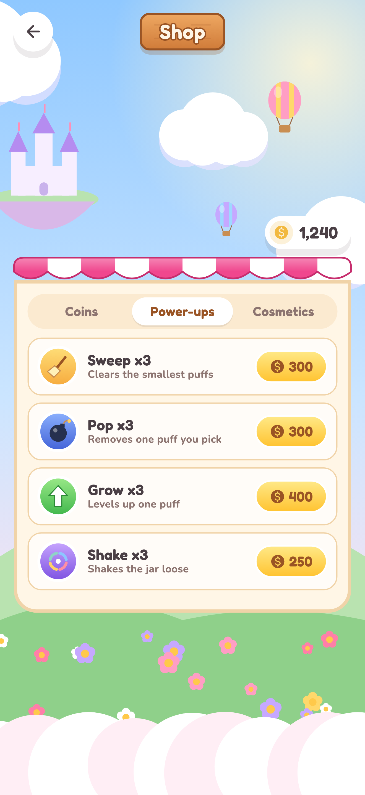
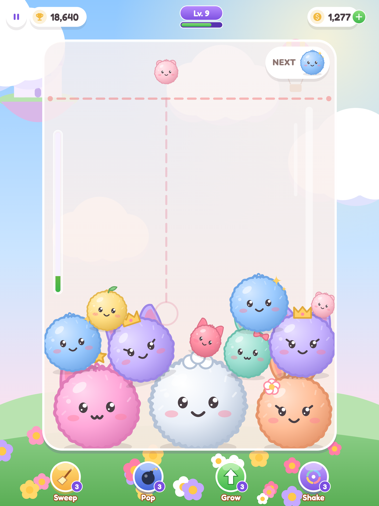
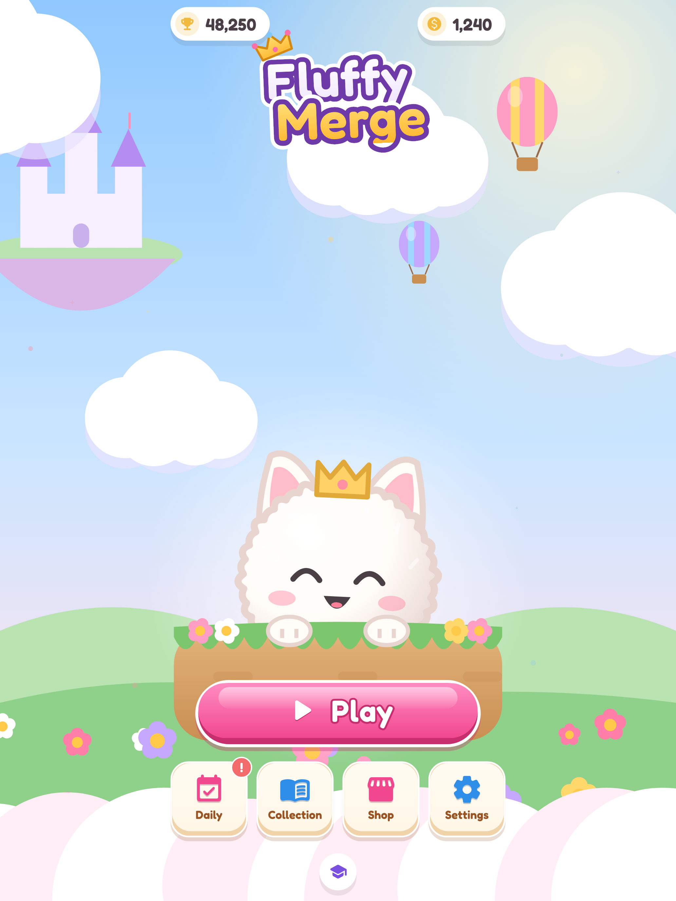
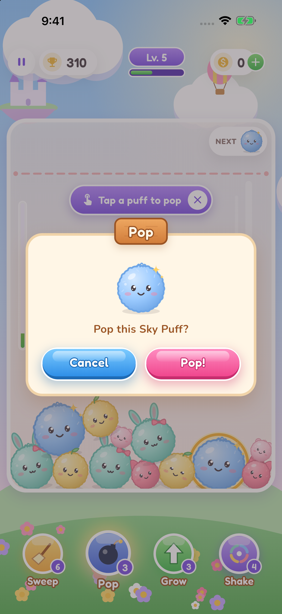

<p align="center">
  
</p>

# Fluffy Merge

**A cozy, physics-based merge puzzle game for Android and iOS, built with Flutter.**

Drop fluffy plush creatures into a glass jar. When two of the same kind touch, they squish together into the next, bigger puff. Chain merges for combos, use power-ups to get out of a tight spot, and don't let the jar overflow. It's easy to learn in five seconds and hard to put down.

Everything you see (the 12 creatures, the storybook backdrop, the jar, the buttons and the particles) is drawn **in code**, and every sound is synthesized by a script in this repo. The game ships with **no image assets** and no third-party art or audio.

**Category:** Games · Puzzle / Casual  ·  **Platforms:** Android 7+ and iOS 15+ (phones and tablets)  ·  **Works offline, no account, no data collected**

---

## Screenshots

| Gameplay | Home | Results |
|:---:|:---:|:---:|
|  |  |  |
| **Collection** | **Daily Challenge** | **Shop** |
|  |  |  |

<details>
<summary>Tablet (iPad 13")</summary>

| Gameplay | Home |
|:---:|:---:|
|  |  |

</details>

<details>
<summary>More in-game captures</summary>

| Power-ups | Pause |
|:---:|:---:|
|  |  |

</details>

App icon: 

---

## Features

### Gameplay
- **Real 2D physics:** native **Box2D v3** through Forge2D. It runs at a fixed 120 Hz step, so play feels smooth and stays deterministic, piles stack stably, resting bodies go to sleep, and speed caps prevent creatures passing through each other.
- **Drag to aim, release to drop:** a dashed guide and a ghost outline show where a creature will land, and a NEXT preview shows what's coming.
- **Same-level merges with chain reactions.** Merge detection never fires twice for the same pair and never uses a creature in two merges at once.
- **12 creature levels**, from Tiny Puff to Rainbow Puff. Two Rainbow Puffs pop in a burst that clears both.
- **Score and combos:** +10, +20, +40, +80… for merges in quick succession, with floating "MERGE!", "COMBO x3!" and "AMAZING!" popups.
- **Game over:** an overflow countdown that ignores brief bounces over the line, a slow-motion ending, then the **"So Fluffy!"** results screen.

### Power-ups
| | |
|---|---|
| **Sweep** | Clears the smallest puffs (confirms first) |
| **Pop** | Tap a puff to remove it (confirms first, with a preview) |
| **Grow** | Tap a puff to upgrade it by one level, which can set off a merge |
| **Shake** | Tosses the pile to loosen it up |

Counts are saved between sessions. More are earned in play by reaching Lv. 6, 8, 10 and 12, or a 5× combo.

### Progression
- **Daily Challenge:** a new goal every day (score, level, merges, combo or drops) with a coin and power-up reward, plus a **7-day login streak**.
- **Collection:** a book of all 12 puffs, with names, personalities and a "NEW" badge for each fresh discovery.
- **Shop:** spend coins on power-up bundles, **jar skins** and **storybook scenes**. Optional coin packs are real in-app purchases.
- **How to Play:** a five-step illustrated guide.
- **Saved safely:** a versioned save file with migrations, a backup copy and corruption recovery. Progress is banked even if the app is killed mid-run.

### Sound and haptics
- Original synthesized sound effects (pops that rise in pitch with creature level, combo arpeggios, soft bounces) and a looping music track.
- Haptics for drops, merges and big moments. Music, sound, volume and haptics can each be switched off in Settings.

### Respectful monetization
- **No ads in this release.** The ad system sits behind an interface, ready for a network later, with strict rules built in:
  - rewarded ads are always optional (2× coins, one continue per run, one free power-up);
  - interstitials only between runs, never in a player's first 3 games, at most every 3rd run and 3+ minutes apart;
  - "Remove Ads" is only sold in builds that actually show ads.
- In-app purchases go through Google Play Billing / StoreKit (`in_app_purchase`). The shop says "coming soon" until the store products exist.
- Analytics events (game_started, merge_created, purchase_completed …) go through an interface with no provider wired in, so **nothing is collected**.

### Feel and polish
- Plush creatures with breathing, blinking, squash-and-stretch on impact, and moods: happy, surprised, squished, excited, **worried** when the jar is nearly full, and **wink** after a chain.
- Pooled particle bursts and shockwave rings, a pulsing danger line, a fullness meter, and a wobbling jar.
- An animated storybook scene with clouds, balloons and a floating castle; candy buttons and wooden signs.
- **Accessibility:** follows the system reduce-motion setting, caps very large text scales so layouts hold, labels every control for screen readers, and never relies on colour alone.
- **Responsive:** small phones to tablets; the playfield keeps its exact proportions on every screen.

---

## Tech stack

| | |
|---|---|
| Framework | Flutter 3.47 (Dart 3.13) |
| Game engine | [Flame](https://pub.dev/packages/flame) 1.38 |
| Physics | [flame_forge2d](https://pub.dev/packages/flame_forge2d) 0.20 (native Box2D v3 via FFI) |
| State | [Riverpod](https://pub.dev/packages/flutter_riverpod) 3 |
| Storage | [shared_preferences](https://pub.dev/packages/shared_preferences) |
| Audio | [audioplayers](https://pub.dev/packages/audioplayers) (low-latency pools) |
| Purchases | [in_app_purchase](https://pub.dev/packages/in_app_purchase) (Play Billing / StoreKit) |
| Fonts | Fredoka and Nunito, bundled in `assets/fonts` (SIL Open Font License) |

## Project structure

```
lib/
├── app/                 # App shell, routes, theme & typography
├── core/
│   ├── constants/       # Colours, sizes, game tuning, app info
│   ├── services/        # ads, analytics, audio, haptics, payments (interfaces + impls)
│   └── utils/           # Responsive layout, reduce-motion, injectable clock
├── data/
│   ├── local/           # Versioned save document, store with backup & migrations
│   └── repositories/    # SaveController: the single source of truth
├── game/                # Flame + Forge2D game (no Flutter UI code)
│   ├── components/      # Creatures, dropper, particles, popups, danger line
│   ├── models/          # Creature catalogue, merge events, run results
│   ├── physics/         # Fixed-step world, jar walls, physics tuning
│   ├── rendering/       # Procedural creature renderer (cached layers)
│   └── systems/         # Merge detection, scoring, power-ups, overflow
├── features/            # home, gameplay, results, daily, collection, shop,
│                        # settings, tutorial, splash
└── widgets/             # Candy buttons, wood signs, dialogs, scene, etc.

tool/                    # Asset generators: audio, app icons, store screenshots,
                         # Android upload-key script
store/                   # Store release kit: icons, screenshots, listing text
```

Game state lives in the Flame game and is exposed to the UI through `ValueNotifier`s and listeners. Screens never reach into physics directly.

---

## Getting started

```bash
git clone https://github.com/Sameer348/Fluffy-Merge-Puzzle-Game.git
cd Fluffy-Merge-Puzzle-Game
flutter pub get
flutter run
```

Box2D is compiled from C during the build through Dart's native-assets hooks. **Android builds need the Android NDK** (Android Studio → SDK Manager → NDK). iOS needs Xcode.

Fonts and sounds are bundled, so the app makes no network requests.

### Tests

```bash
flutter test
```

**164 tests** cover:
- **Unit:** merge detection, scoring and combos, the particle pool, the overflow timer, save migrations and corruption recovery, daily challenges and streaks, the shop rules, the interstitial policy, the store adapter.
- **Real physics:** stacking, no tunnelling, deterministic replays, chain reactions, power-up effects, continue-after-game-over.
- **Full UI flows on the real screens:** navigation, power-up pick and confirm, pause, game over through to results, settings, shop purchases, rewarded-ad offers, How to Play, layouts from small phones to tablets.
- **Performance:** frame-cost benchmarks for drawing and physics.

### Wireless Android debugging

```bash
bash tool/pair_android.sh   # finds the phone's pairing port automatically
```

---

## Roadmap

| Phase | | Status |
|---|---|---|
| 1–3 | Project setup, main menu, game board | ✅ |
| 4–6 | Box2D physics, collision detection, merge system | ✅ |
| 7–8 | Score & combos, animations & particles | ✅ |
| 9–10 | Power-ups, game over & results | ✅ |
| 11 | Versioned save model & full persistence | ✅ |
| 12–13 | Daily challenge & 7-day streak, creature collection | ✅ |
| 14 | Shop (coins, power-ups, cosmetics) | ✅ |
| 15 | Audio & haptics | ✅ |
| 16 | Ads / in-app purchase / analytics abstraction | ✅ |
| 17–18 | Optimization, Android & iOS release prep | ✅ |

Leaderboards and achievements are not built yet (no placeholder screens ship).

## Releasing

Store assets (icons, screenshots, feature graphic), listing text, privacy
answers, in-app product IDs and a step-by-step checklist are in
[`store/README.md`](store/README.md). The privacy policy is
[`docs/privacy_policy.md`](docs/privacy_policy.md).

---

## Design notes

- An **original** game in the "cute physics merge" genre. The name, creatures, art and UI are all made for this project.
- Monetization is designed to be respectful. Rewarded ads are always optional. No interstitials mid-run, and none in this release at all.
- Privacy by default: progress stays on the device; see the [privacy policy](docs/privacy_policy.md).
