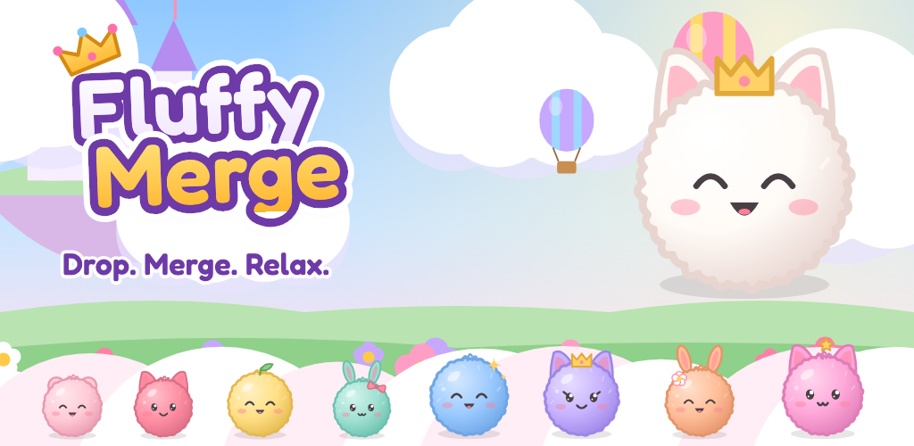
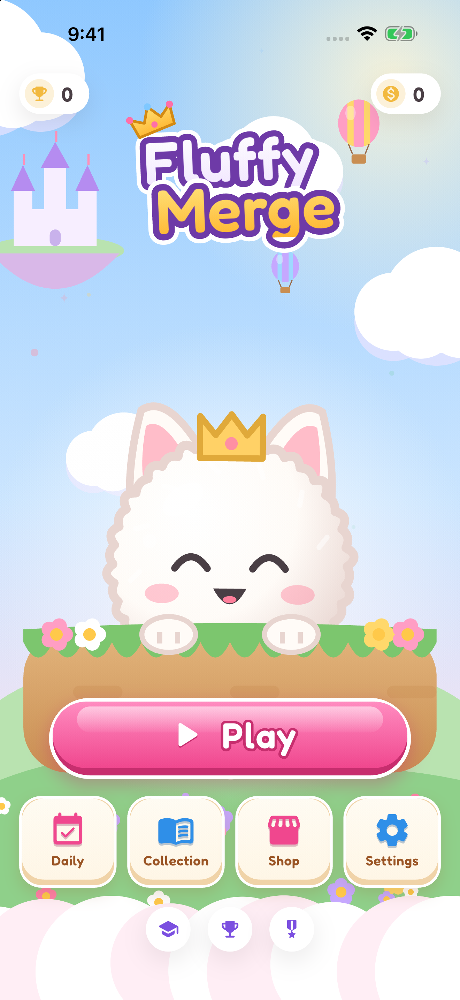
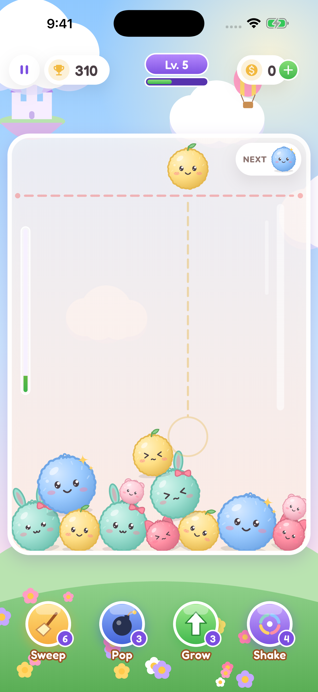
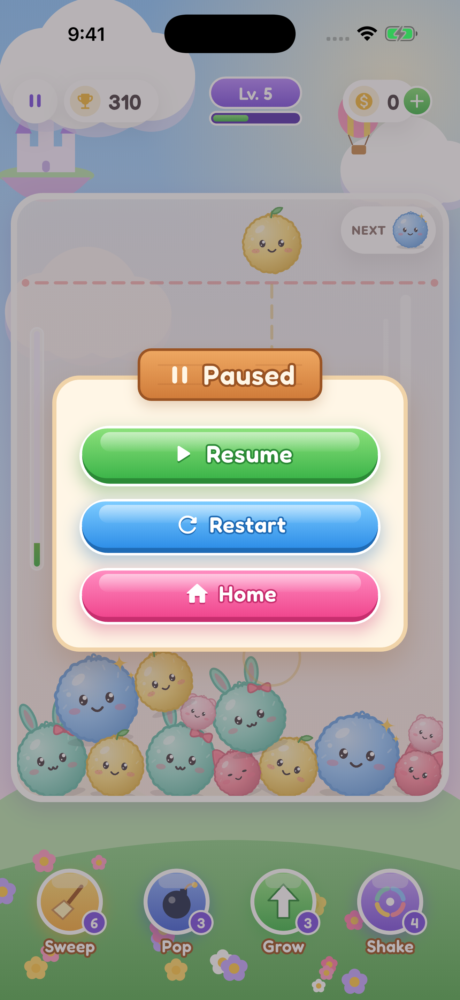
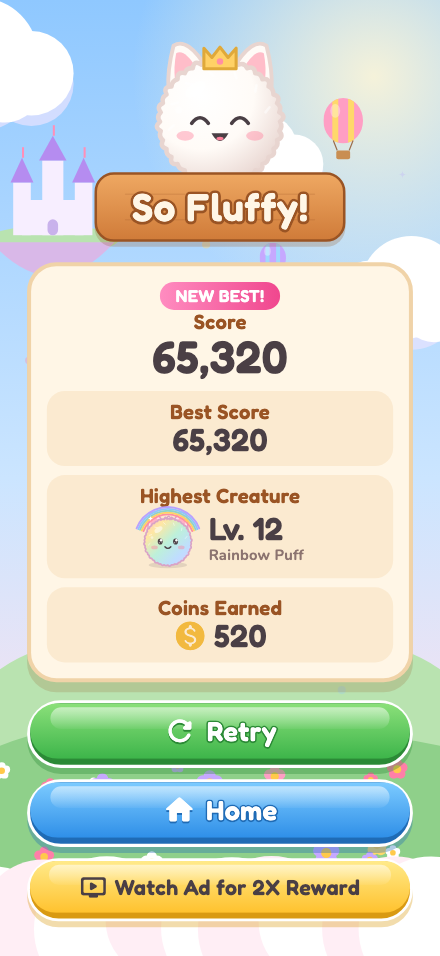

<p align="center">
  
</p>

# Fluffy Merge

**A cozy, physics-based merge puzzle game for Android and iOS, built with Flutter.**

Drop fluffy plush creatures into a glass jar. When two of the same kind touch, they squish together into the next, bigger puff. Chain merges for combos, use power-ups to get out of a tight spot, and don't let the jar overflow. It's easy to learn in five seconds and hard to put down.

Everything you see (the 12 creatures, the storybook backdrop, the jar, the buttons and the particles) is drawn **in code**. The game ships with **no image assets**.

---

## Screenshots

| Home | Gameplay | Power-ups |
|:---:|:---:|:---:|
|  |  |  |
| **Pause** | **Results** | |
|  |  | |

---

## Features

### Gameplay
- **Real 2D physics:** native **Box2D v3** through Forge2D. It runs at a fixed 120 Hz step, so play feels smooth and stays deterministic, piles stack stably, resting bodies go to sleep, and speed caps prevent creatures passing through each other.
- **Drag to aim, release to drop:** a dashed guide and a ghost outline show where a creature will land, and a NEXT preview shows what's coming.
- **Same-level merges with chain reactions.** Merge detection never fires twice for the same pair and never uses a creature in two merges at once.
- **12 creature levels**, from Tiny Puff to Rainbow Puff. Two Rainbow Puffs pop in a burst that clears both.
- **Score and combos:** +10, +20, +40, +80… for merges in quick succession, with floating "MERGE!", "COMBO x3!" and "AMAZING!" popups.
- **Game over:** an overflow countdown that ignores brief bounces over the line, a slow-motion ending, then the **"So Fluffy!"** results screen.

### Power-ups
| | |
|---|---|
| **Sweep** | Clears the smallest puffs (confirms first) |
| **Pop** | Tap a puff to remove it (confirms first, with a preview) |
| **Grow** | Tap a puff to upgrade it by one level, which can set off a merge |
| **Shake** | Tosses the pile to loosen it up |

Counts are saved between sessions. More are earned in play by reaching Lv. 6, 8, 10 and 12, or a 5× combo.

### Feel and polish
- Plush creatures with breathing, blinking, squash-and-stretch on impact, and moods: happy, surprised, squished, excited, **worried** when the jar is nearly full, and **wink** after a chain.
- Pooled particle bursts and shockwave rings, a pulsing danger line, a fullness meter, and a wobbling jar.
- An animated storybook scene with clouds, balloons and a floating castle; candy buttons and wooden signs.
- **Accessibility:** follows the system reduce-motion setting, caps very large text scales so layouts hold, labels every control for screen readers, and never relies on colour alone.
- **Responsive:** small phones to tablets; the playfield keeps its exact proportions on every screen.

---

## Tech stack

| | |
|---|---|
| Framework | Flutter 3.47 (Dart 3.13) |
| Game engine | [Flame](https://pub.dev/packages/flame) 1.38 |
| Physics | [flame_forge2d](https://pub.dev/packages/flame_forge2d) 0.20 (native Box2D v3 via FFI) |
| State | [Riverpod](https://pub.dev/packages/flutter_riverpod) 3 |
| Storage | [shared_preferences](https://pub.dev/packages/shared_preferences) |
| Fonts | Fredoka and Nunito via [google_fonts](https://pub.dev/packages/google_fonts) |

## Project structure

```
lib/
├── app/                 # App shell, routes, theme & typography
├── core/
│   ├── constants/       # Colours, sizes, game tuning
│   ├── services/ads/    # AdService interface (no real provider yet)
│   └── utils/           # Responsive layout, reduce-motion
├── data/
│   ├── local/           # SharedPreferences provider & keys
│   └── repositories/    # Progress (best score, coins), power-up inventory
├── game/                # Flame + Forge2D game (no Flutter UI code)
│   ├── components/      # Creatures, dropper, particles, popups, danger line
│   ├── models/          # Creature catalogue, merge events, run results
│   ├── physics/         # Fixed-step world, jar walls, physics tuning
│   ├── rendering/       # Procedural creature renderer
│   └── systems/         # Merge detection, scoring, power-ups, overflow
├── features/            # Screens: home, gameplay, results, + placeholders
└── widgets/             # Candy buttons, wood signs, dialogs, scene, etc.
```

Game state lives in the Flame game and is exposed to the UI through `ValueNotifier`s and listeners. Screens never reach into physics directly.

---

## Getting started

```bash
git clone https://github.com/Sameer348/Fluffy-Merge-Puzzle-Game.git
cd Fluffy-Merge-Puzzle-Game
flutter pub get
flutter run
```

Box2D is compiled from C during the build through Dart's native-assets hooks. **Android builds need the Android NDK** (Android Studio → SDK Manager → NDK). iOS needs Xcode.

Fonts are downloaded on first launch and cached after that.

### Tests

```bash
flutter test
```

**97 tests** cover:
- **Unit:** merge detection, scoring and combos, the particle pool, the overflow timer.
- **Real physics:** stacking, no tunnelling, deterministic replays, chain reactions, power-up effects.
- **Full UI flows on the real screens:** navigation, power-up pick and confirm, pause, game over through to results.

### Wireless Android debugging

```bash
bash tool/pair_android.sh   # finds the phone's pairing port automatically
```

---

## Roadmap

| Phase | | Status |
|---|---|---|
| 1–3 | Project setup, main menu, game board | ✅ |
| 4–6 | Box2D physics, collision detection, merge system | ✅ |
| 7–8 | Score & combos, animations & particles | ✅ |
| 9–10 | Power-ups, game over & results | ✅ |
| 11 | Versioned save model & full persistence | ⏳ |
| 12–13 | Daily challenge & 7-day streak, creature collection | ⏳ |
| 14 | Shop (coins, power-ups, cosmetics) | ⏳ |
| 15 | Audio & haptics | ⏳ |
| 16 | Ads / in-app purchase integration | ⏳ |
| 17–18 | Optimization, Android & iOS release prep | ⏳ |

The Tutorial, Daily Challenge, Collection, Shop, Settings, Leaderboard and Achievements screens are placeholders until their phases.

---

## Design notes

- An **original** game in the "cute physics merge" genre. The name, creatures, art and UI are all made for this project.
- Monetization is designed to be respectful. Rewarded ads are always optional (2× reward). No interstitials mid-run.
